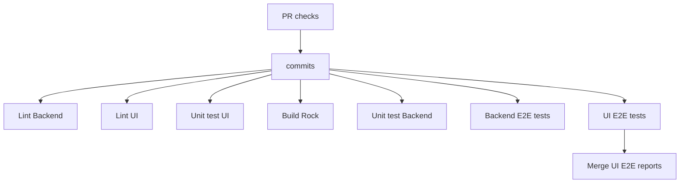

# Cluster Manager architecture

See [Architecture of the MicroCloud Cluster Manager](https://canonical.com/microcloud/docs/latest/reference/cluster-manager-architecture/) for an architecture diagram and further details.

## Deployment constraints

### Single management-api instance

The management API must run as a single instance. Do not scale the charm beyond one unit, for example with `juju scale-application`.

Synchronization of OIDC session state is done in process memory (see `internal/app/management-api/core/auth/session_lock.go`):

- Refresh token redemption is serialized per session, so a refresh token is never redeemed twice concurrently. Identity providers that rotate refresh tokens may reject reuse and revoke the whole token family, logging the user out.
- Renewal of an expired session is serialized per session, and the result is cached briefly so concurrent requests carrying the same stale session cookie reuse the renewed session.

Neither guarantee holds across multiple management-api instances. With more than one instance serving traffic, concurrent requests of the same user can redeem the same refresh token twice, or renew the same expired session twice and invalidate each other's new session.

## Workflows

### PR checks with CI pipeline

For each pull request opened or updated, a series of checks will be applied using [PR GitHub workflow](https://github.com/canonical/microcloud-cluster-manager/actions/workflows/pr.yaml) to ensure code quality.

The most critical CI jobs are the `Backend E2E tests` and the `UI E2E tests` because they execute the end-to-end test suites against the current state of the pull request, thereby preventing regression errors.

Both E2E test scripts use the [run-backend](scripts/run-backend.sh) script to boot a local instance of the cluster manager. This approach ensures that the tests are reliable and fast.

## Code coverage

A dedicated [TICS code scan](https://github.com/canonical/microcloud-cluster-manager/actions/workflows/tics.yaml) workflow is running the unit and e2e tests.

The coverage report uses the [run-coverage](scripts/run-coverage.sh) script to boot a local instance of the cluster manager with coverage reporting enabled. This allows the workflow to collect coverage data from both the backend and the UI. Providing a comprehensive view of the code coverage for the entire project.
